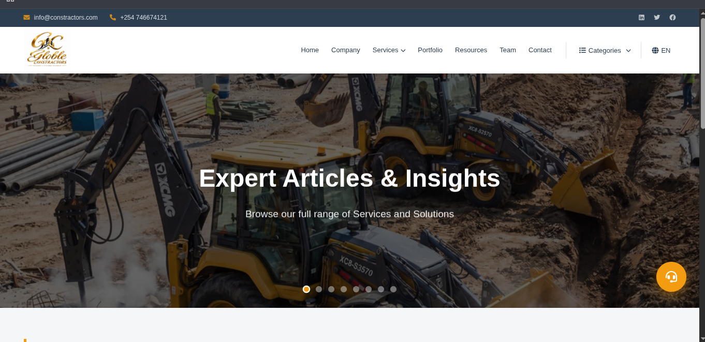
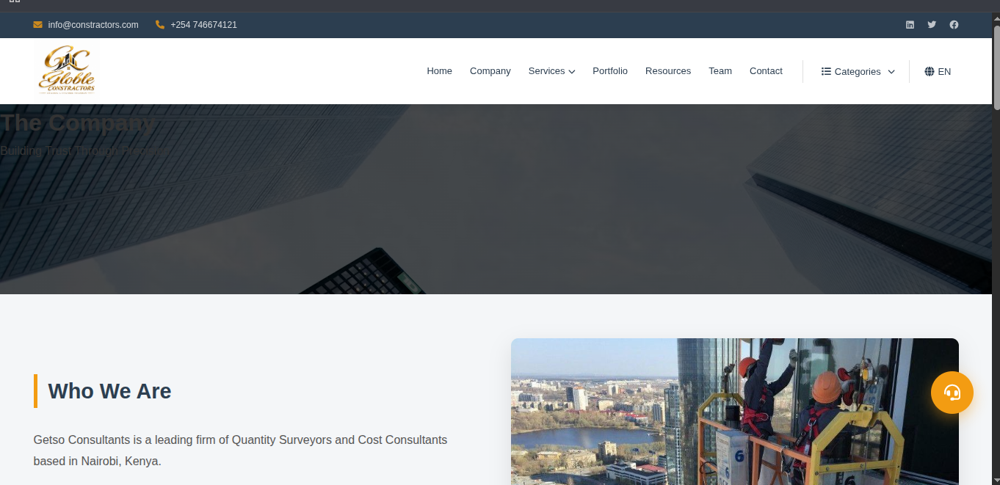
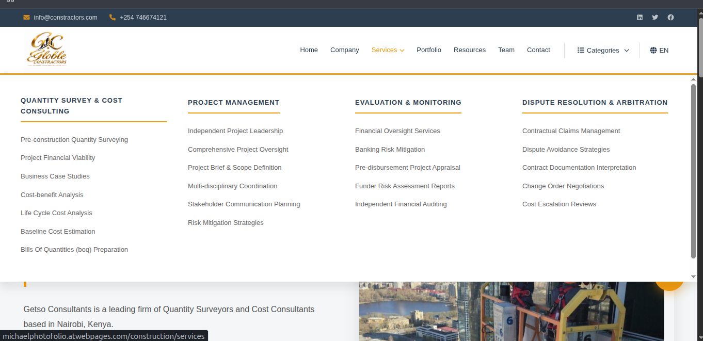
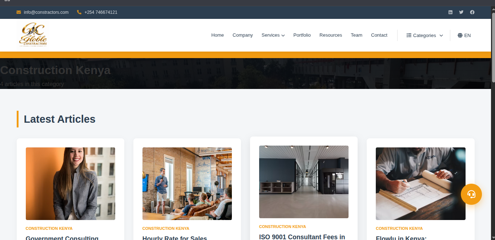
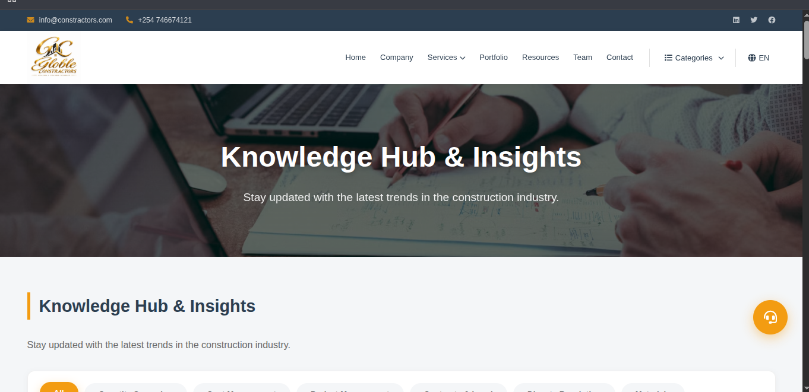
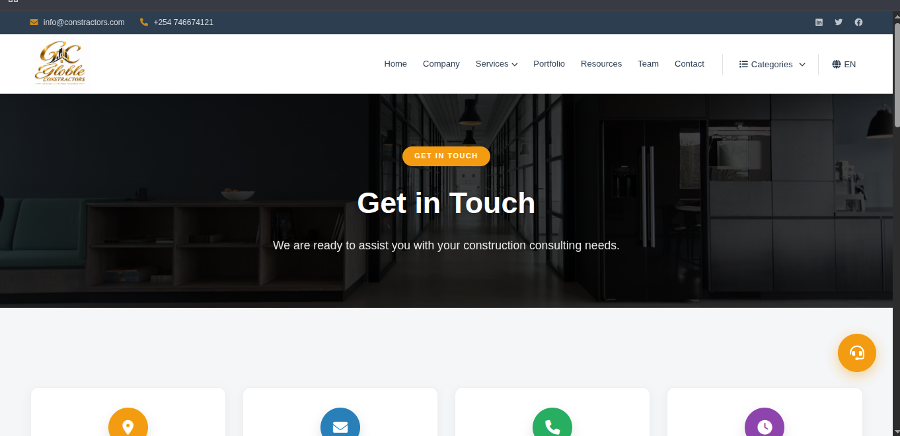

# BuildRight Construction | Corporate Website


A full-stack, responsive corporate website for a construction company. This project features a professional storefront showcasing services, project categories, and company information, along with a secure admin dashboard for managing content and inquiries.

**🔗 [View Live Demo](http://michaelphotofolio.atwebpages.com/construction/)**

---

## 📸 Screenshots

Here is a preview of the key pages in the application:

| Home Page | About Us | Services |
| :---: | :---: | :---: |
|  |  |  |

| Categories | Resources | Contact |
| :---: | :---: | :---: |
|  |  |  |

---

## ✨ Features

**Public Frontend:**
- **Responsive Design:** Fully optimized for mobile, tablet, and desktop — critical for on-site clients browsing from their phones.
- **Service Showcase:** Dedicated page detailing residential, commercial, and renovation services.
- **Project Categories:** A categorized portfolio allowing visitors to filter construction projects by type.
- **Resources Section:** A page for helpful content, guides, or company documentation.
- **Contact & Quote Request:** A functional contact form for client inquiries.
- **Company Information:** About page highlighting experience, mission, and team.

**Admin Dashboard (Backend):**
- **Secure Admin Login:** Separate authentication for administrators.
- **Dashboard Overview:** Central hub for managing site content.
- **Category Management:** Add, edit, and delete project categories.
- **Inquiry Management:** View and respond to customer contact submissions.
- **Service Management:** Update service descriptions and details.

---

## 🛠️ Tech Stack

**Frontend:**
- HTML5
- CSS3 (Flexbox, Grid, Custom Properties)
- JavaScript (ES6+)

**Backend:**
- PHP (Server-side scripting)
- MySQL (Database for projects, categories, and inquiries)

**Tools & Deployment:**
- Git & GitHub for version control
- [XAMPP / WAMP / MAMP] for local development
- [VS Code] as the code editor
- [InfinityFree / 000webhost] for live hosting

---

## 🚀 Getting Started

To get a local copy up and running, follow these simple steps.

### Prerequisites
You will need a local server environment that supports PHP and MySQL.
- [XAMPP](https://www.apachefriends.org/index.html) (Recommended for beginners)
- Or [WAMP](https://www.wampserver.com/en/) / [MAMP](https://www.mamp.info/en/)

### Installation

1. Clone the repository into your local server's root directory (e.g., `htdocs` for XAMPP):
   ```bash
   git clone https://github.com/Michael237-web/construction-website.git
